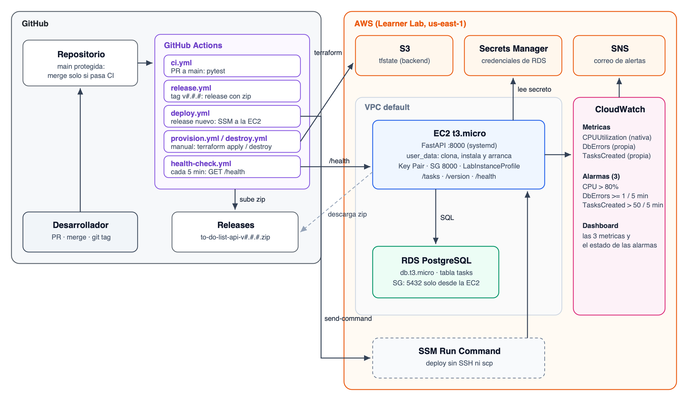

# to-do-list-api

API para gestionar tareas pendientes, persistidas en RDS PostgreSQL. La infraestructura se crea con Terraform, se prueba, libera y despliega con GitHub Actions, y se monitorea con CloudWatch.



## Endpoints

| Endpoint | Descripcion |
|----------|-------------|
| `GET /tasks` | Lista de tareas |
| `POST /tasks` | Crea una tarea: `{"title": "...", "done": false}` |
| `GET /version` | Version desplegada (variable de ambiente `APP_VERSION`) |
| `GET /health` | Conexion a la base de datos (`OK`/`FAIL`), version y timestamp. Responde 503 si la base no responde |

```bash
curl -X POST http://<ip-de-tu-ec2>:8000/tasks \
  -H "Content-Type: application/json" \
  -d '{"title": "estudiar para el examen de desarrollo en la nube", "done": false}'

curl http://<ip-de-tu-ec2>:8000/tasks
```

## Estructura

```
src/                  API (FastAPI): main.py, db.py, metrics.py
tests/                pruebas unitarias (pytest)
terraform/            main.tf, variables.tf, outputs.tf, user_data.sh.tftpl
alerting/             alarms.json y cloudwatch-dashboard.json (los lee Terraform)
scripts/              scripts para la consola de AWS Academy
.github/workflows/    provision, destroy, ci, release, deploy, health-check
docs/                 diagrama de arquitectura
```

## Configuracion de la app

La app no tiene ningun valor hardcodeado, todo llega por variables de ambiente que escribe `user_data` en `/etc/todo-api.env`:

| Variable | Uso |
|----------|-----|
| `DB_SECRET_ID` | Nombre del secreto en Secrets Manager. La app lo lee al conectarse y toma host, puerto, base, usuario y contrasena |
| `APP_VERSION` | Version que regresa `/version`. La actualiza el deploy |
| `AWS_REGION` | Region de Secrets Manager y CloudWatch |
| `METRICS_NAMESPACE` | Namespace de las metricas propias (`TodoList`) |

La EC2 usa el perfil `LabInstanceProfile` del lab, asi que puede leer el secreto y publicar metricas sin llaves de AWS.

## Correr en local

Con Docker:

```bash
docker run -d --name todo-pg -p 5432:5432 -e POSTGRES_USER=todo -e POSTGRES_PASSWORD=local -e POSTGRES_DB=todo postgres:16-alpine
python3 -m venv .venv && source .venv/bin/activate
pip install -r requirements-dev.txt
cd src
DB_HOST=localhost DB_NAME=todo DB_USER=todo DB_PASSWORD=local METRICS_ENABLED=false uvicorn main:app --reload
```

Sin `DB_SECRET_ID` la app usa las variables `DB_*`, solo para desarrollo local.

Pruebas:

```bash
pytest -v
```

## Infraestructura en AWS Academy

Todo se corre desde la consola de AWS Academy (CloudShell) y desde GitHub Actions. Los workflows necesitan las credenciales del lab como secrets del repo; `scripts/github-secrets.sh` las copia.

### 1. Preparar (cada vez que se inicia el lab)

1. Start Lab y abrir CloudShell.
2. Clonar el repo:

   ```bash
   git clone https://github.com/yair91/to-do-list-api.git
   cd to-do-list-api
   ```

3. Solo la primera vez, crear el bucket del tfstate:

   ```bash
   bash scripts/crear-backend.sh
   ```

4. Copiar las credenciales del lab a GitHub. Las del lab caducan, hay que repetirlo en cada sesion. El correo para las alarmas solo hace falta la primera vez:

   ```bash
   bash scripts/github-secrets.sh tu@correo.com
   ```

   La primera vez instala `gh` en `~/bin` y pide iniciar sesion en GitHub con un codigo. Usa las credenciales de `~/.aws/credentials` si existen (el bloque de AWS Details del lab) y si no, las de CloudShell.

### 2. Crear la infraestructura

En GitHub: **Actions > Provision > Run workflow**, o desde CloudShell:

```bash
~/bin/gh workflow run provision.yml
```

Terraform crea Security Groups, Key Pair, RDS, el secreto en Secrets Manager, la EC2 con `user_data`, el topico SNS, las 3 alarmas y el dashboard. El state queda en `s3://todo-tfstate-<cuenta>/to-do-list-api/terraform.tfstate`. El workflow espera a que `/health` responda y deja las URLs en el resumen.

Despues hay que **confirmar la suscripcion** desde el correo que manda SNS.

### 3. Release y deploy

```bash
git tag v1.0.0
git push origin v1.0.0
```

- **Release** crea el release en GitHub con el repositorio en zip.
- Al terminar, **Deploy** manda por SSM a la EC2 un script que descarga el zip, instala dependencias, cambia `APP_VERSION` y reinicia el servicio. Al final confirma con `GET /version` que quedo la version nueva.

### 4. Destruir

**Actions > Destroy > Run workflow** y escribir `destruir`, o:

```bash
~/bin/gh workflow run destroy.yml -f confirmacion=destruir
```

El bucket del tfstate no se borra, para no perder el state entre sesiones del lab.

## CI

`ci.yml` corre las pruebas en cada PR a `main`. La rama `main` esta protegida: solo se puede hacer merge si el check `tests` pasa.

## Observabilidad

### Metricas

| Metrica | Tipo | Que dice |
|---------|------|----------|
| `AWS/EC2 CPUUtilization` | nativa | Carga de la instancia |
| `TodoList DbErrors` | propia (`put_metric_data`) | Errores al leer o escribir en RDS, incluido `/health` |
| `TodoList TasksCreated` | propia (`put_metric_data`) | Tareas creadas: actividad real de los usuarios |

### Alarmas

Definidas en `alerting/alarms.json`. Las 3 notifican al topico SNS `todo-api-alertas` (correo), tanto al dispararse como al volver a OK.

| Alarma | Condicion | Por que | Que haria |
|--------|-----------|---------|-----------|
| `todo-api-ec2-cpu-alta` | CPU promedio > 80% en 2 de 3 periodos de 5 min | Un pico corto es normal; dos periodos altos de tres es carga sostenida | Revisar procesos en la instancia, subir el tipo de instancia o escalar |
| `todo-api-errores-rds` | `DbErrors` >= 1 en 5 min | Cada error significa que un usuario recibio 503; la app no tiene reintentos | Revisar el estado de RDS, el security group y el secreto |
| `todo-api-pico-de-tareas` | `TasksCreated` > 50 en 5 min | Una persona no crea 50 tareas en 5 min; probablemente es un script o un cliente en loop | Revisar quien las crea y limitar peticiones |

### Dashboard

`alerting/cloudwatch-dashboard.json`: las 3 metricas con la linea del umbral de su alarma y el estado de las alarmas.

### Probar las alarmas

```bash
bash scripts/rds.sh detener          # tarda unos minutos
bash scripts/probar-api.sh errores 10
# llega el correo de todo-api-errores-rds
bash scripts/rds.sh arrancar

bash scripts/probar-api.sh pico 60   # dispara todo-api-pico-de-tareas
```

`health-check.yml` revisa `/health` cada 5 minutos. Con RDS detenida el workflow falla y tambien suma errores a `DbErrors`.
