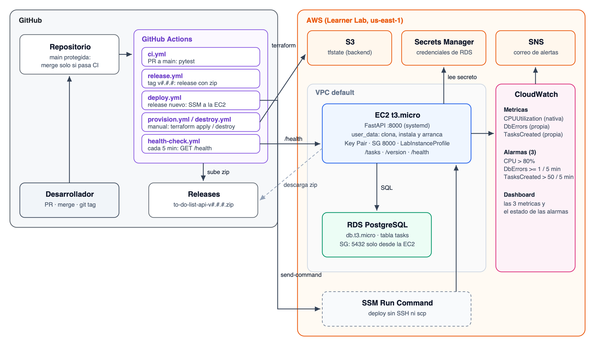

**Yair Emmanuel Arias Madera** · Desarrollo en la Nube · Practica 4: To-Do List (CI/CD + Observabilidad) · <fecha>

Repositorio: https://github.com/yair91/to-do-list-api

## Descripcion del proyecto

to-do-list-api es una API en FastAPI para registrar tareas pendientes. Expone `GET /tasks` y `POST /tasks`, que leen y escriben en RDS PostgreSQL; `GET /version`, que regresa la version desplegada leida de la variable `APP_VERSION`; y `GET /health`, que prueba la conexion a la base y regresa OK/FAIL, la version y un timestamp.

Toda la infraestructura se crea con Terraform desde GitHub Actions: una EC2 con su Security Group y Key Pair, RDS en la VPC default (accesible solo desde la EC2), un secreto en Secrets Manager con las credenciales que la app lee al conectarse, el topico SNS, tres alarmas y un dashboard de CloudWatch. El tfstate vive en S3. Al arrancar, la EC2 corre `user_data`, que clona el repositorio, instala dependencias y levanta la API con systemd.

El pipeline tiene cuatro partes: CI corre las pruebas en cada PR y bloquea el merge a `main` si fallan; una etiqueta `v#.#.#` crea un release con el zip del repo; al terminar el release, el deploy manda por SSM un script a la EC2 que descarga ese zip, reinicia el servicio y confirma la version con `/version`; y un workflow revisa `/health` cada 5 minutos.

## Preguntas de reflexion

**1. ¿Que ventaja concreta notaste al provisionar con Terraform en lugar de hacerlo a mano o con bash?**

La ventaja mas clara fue poder destruir y volver a crear todo sin pensar. El Learner Lab se reinicia seguido y con Terraform recrear la EC2, RDS, el secreto, las alarmas y el dashboard es correr un workflow; con bash tendria que escribir a mano la logica de "si ya existe no lo crees", el orden entre recursos y, sobre todo, el borrado en orden inverso. Algo que me hubiera costado mucho mas sin Terraform es conectar los recursos entre si: el security group de RDS que solo acepta a la EC2, el host de RDS que se guarda en el secreto y el ID de la instancia que usan la alarma de CPU y el dashboard. Terraform resuelve esas dependencias solo y me dice en el plan que va a cambiar antes de tocar nada. Tener el state en S3 permite que el workflow de destroy sepa exactamente que borrar aunque lo corra en otra sesion.

Con `scp` copiaba los archivos a una instancia que ya existia y despues entraba por SSH a instalar y arrancar la app; si recreaba la instancia tenia que repetir todo. `user_data` hace lo mismo pero como parte de la definicion de la instancia: corre una sola vez al arrancar, clona el repo, instala dependencias y deja la API como servicio. Asi cada instancia nueva queda lista sin que yo intervenga, y no necesito abrir el puerto 22 ni manejar la llave privada. La diferencia es que `scp` es un paso manual despues de crear la maquina, mientras que `user_data` es parte de crearla.

**2. ¿Que pasos manuales dejaste de hacer y que riesgo corrias antes?**

Deje de correr las pruebas a mano antes de subir cambios, de comprimir y subir el codigo, de entrar por SSH a la EC2 a descargar la version nueva y reiniciar el servicio, y de revisar a mano que la version correcta quedara corriendo. Antes podia subir a `main` codigo con pruebas rotas porque se me olvidaba correrlas, desplegar una version distinta a la que creia (archivos sin commitear o la rama equivocada) o dejar el servicio caido si me equivocaba en un comando al reiniciar. Ahora `main` no acepta un PR con pruebas fallando, lo que se despliega es siempre el zip de un release con etiqueta, y el deploy falla si `/version` no regresa la etiqueta esperada.

**3. Alarma elegida: `todo-api-errores-rds` (DbErrors >= 1 en 5 minutos)**

*Situacion real.* RDS se detiene o se reinicia por mantenimiento, se llena el almacenamiento, alguien cambia el security group o se rotan las credenciales y el secreto queda desactualizado. En la practica la provoque deteniendo la instancia de RDS.

*Diagnostico con el dashboard.* En la grafica de DbErrors se ve el momento exacto en que empiezan los errores. Si al mismo tiempo la CPU de la EC2 esta normal y TasksCreated cae a cero, el problema no es carga ni la app: la app esta viva pero no llega a la base. Despues confirmaria con `/health` (que regresa `FAIL`) y el estado de la instancia en la consola de RDS.

*Accion.* Si RDS esta detenida o reiniciandose, arrancarla y esperar a que este disponible; si es el security group o el secreto, corregirlo en Terraform y aplicar. Al volver a funcionar, la alarma regresa a OK y llega el correo de recuperacion.

## Anexos

1. Dashboard en CloudWatch
2. Alarma `todo-api-errores-rds` en estado ALARM y correo recibido
3. tfstate en S3
4. Ejecuciones de los workflows en GitHub Actions
